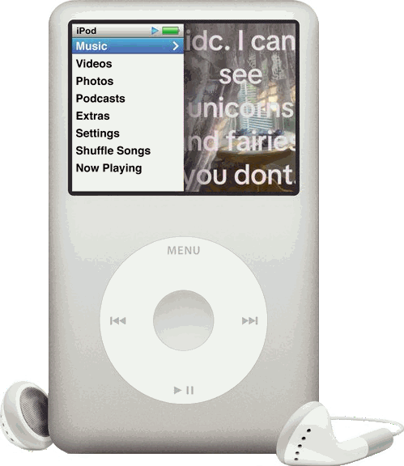
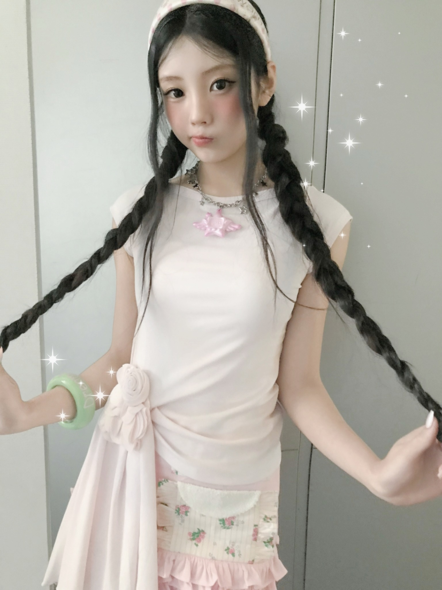
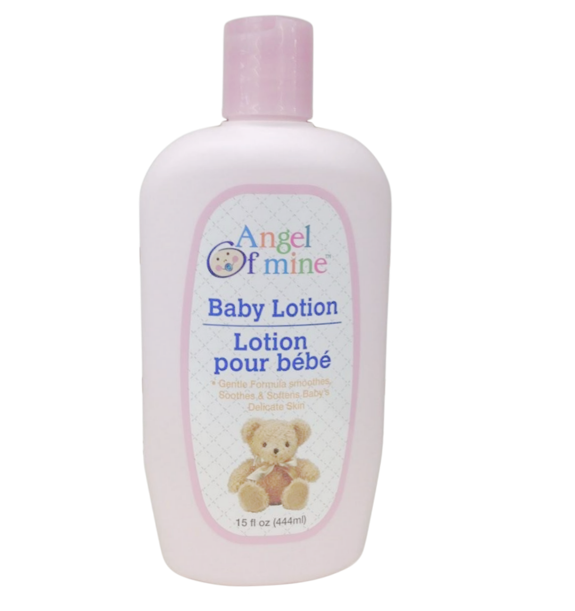
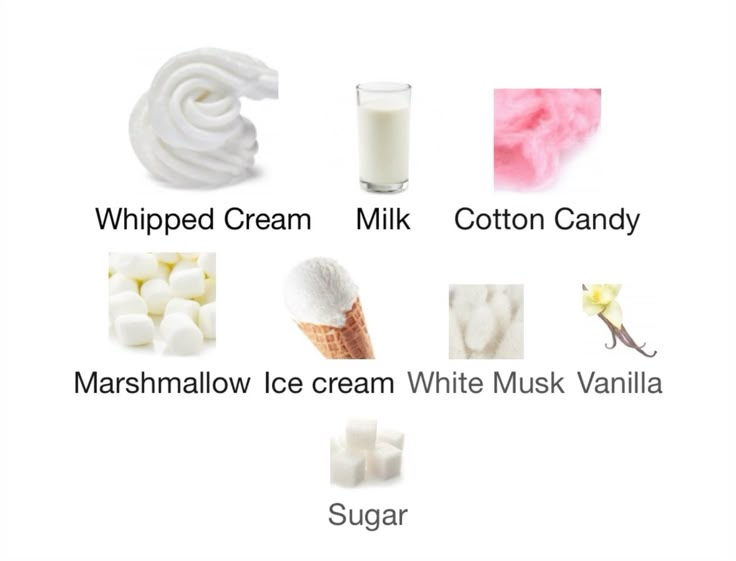
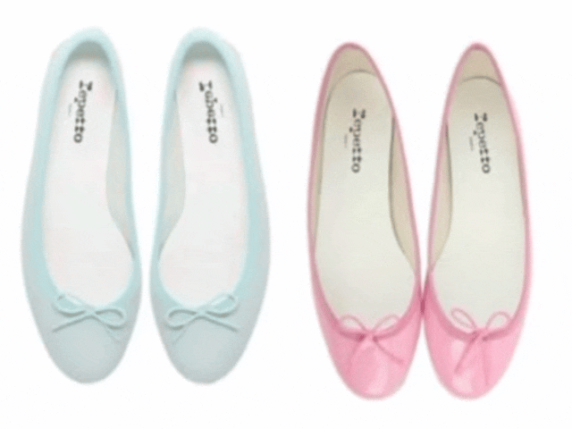
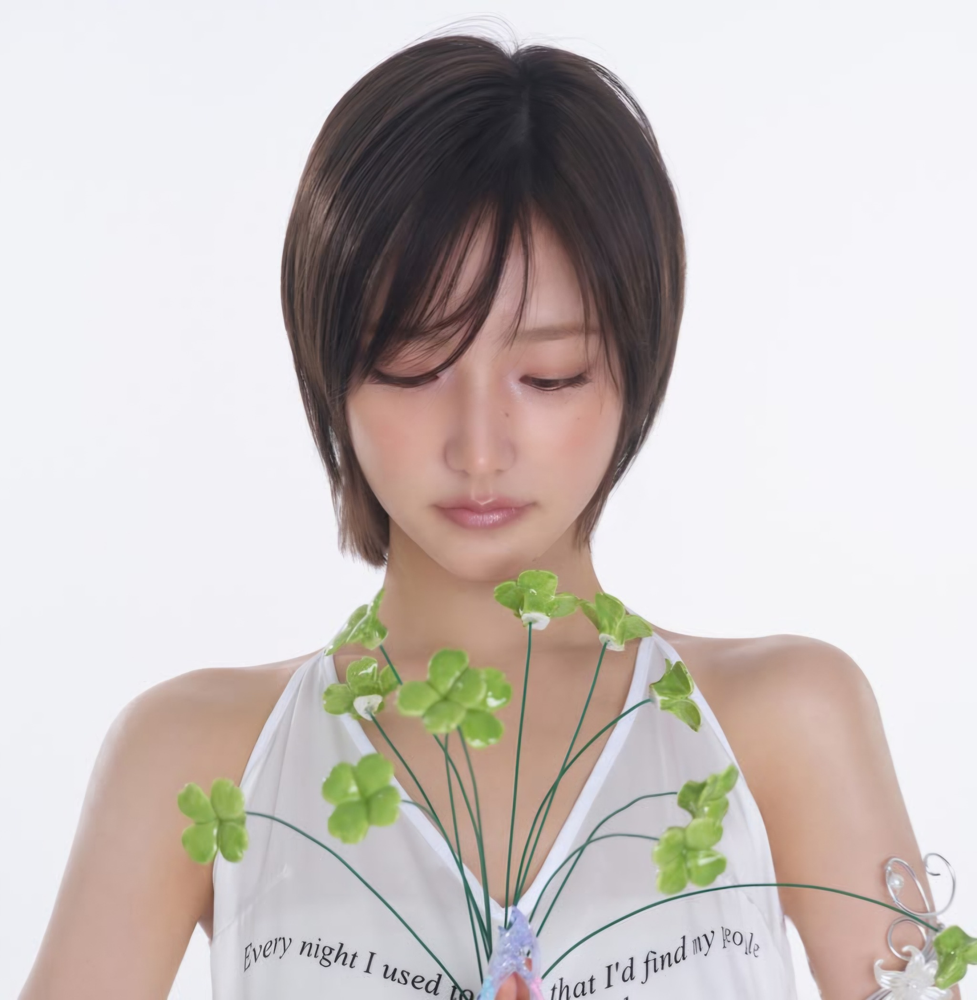
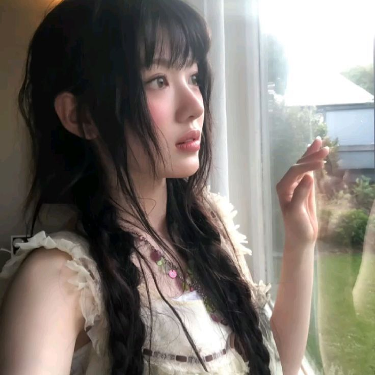
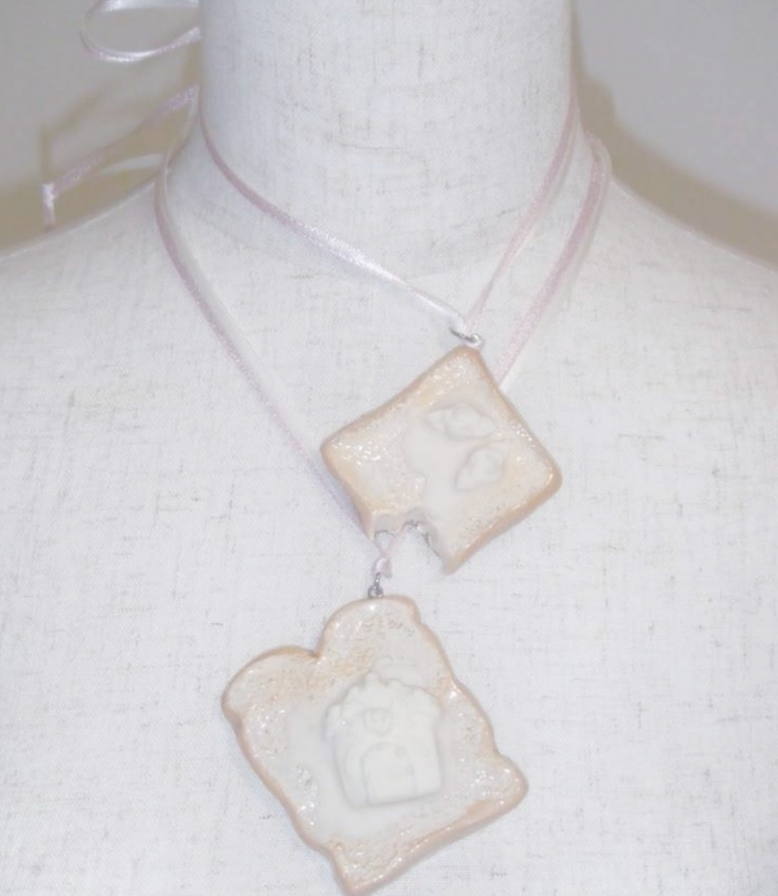
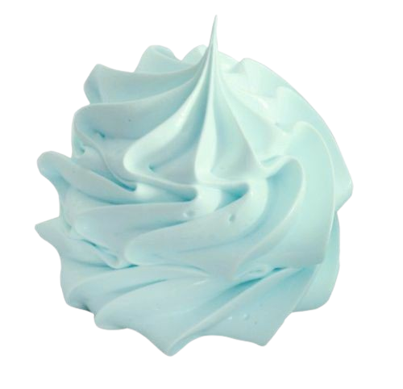

<!-- NOTEBOOK RINGS / TOP BANNER -->

  

<!-- HEADER TITLE -->
<h1>˚ ༘ ೀ ⋆｡˚ <i>soro de leite</i> ˚｡⋆ ೀ ༘ ˚</h1>

  <i>"How can I get into someone's dream? i need to deliver a message . . . ✧"</i> 
  ♡ 🍼 ♡ 🍼 ♡ 🍼 ♡ 🍼 ♡ 
  *ੈ✩‧₊˚ ♫ ﾟ･*:.｡. .｡.:*･゜ﾟ･* 🪽

<!-- SCISSORS & HALO DIVIDER -->

  

<!-- IPOD (ANIMADO COM AS FOTOS) -->

  

<!-- PIXEL LACE DIVIDER -->

  

<!-- MOODBOARD / SCRAPBOOK GRID 1 -->
<table>
  <tr>
    <td width="33.3%" align="center">
      
    </td>
    <td width="33.3%" align="center">
      
    </td>
    <td width="33.3%" align="center">
      
    </td>
  </tr>
</table>

 

<!-- AESTHETIC QUOTE -->

  <i>"my hobbies? Uhhhhh symbolism mostly. metaphors and implications and the like."</i> 
  .・。.・゜✭・.・✫・゜・。.  
  ♪ ˚ · . ౨ৎ . · ˚ ♫

 

<!-- FRAGRANCE NOTE SECTION -->

<b>─── ⋆⋅☆⋅⋆ ─── olfactory notes ─── ⋆⋅☆⋅⋆ ───</b>

  

<!-- MOODBOARD / SCRAPBOOK GRID 2 -->
<table>
  <tr>
    <td width="50%" align="center">
      
    </td>
    <td width="50%" align="center">
      
    </td>
  </tr>
  <tr>
    <td width="50%" align="center">
      
    </td>
    <td width="50%" align="center">
      
    </td>
  </tr>
</table>

  

<!-- ABOUT ME / STATUS -->

  ೀ <b>about me</b> ೀ  
  <i>sorodeleite</i> ᰔ she/her ᰔ aesthetic curation &amp; code  
  <i>listening to:</i> 🎧 dream pop &bull; shoegaze &bull; k-pop ✨

 

<!-- FOOTER WITH MERINGUE & KAOMOJI -->
 

  ค ค  p♡ω,p♡ω  ค ค 
  . ˚ . ✦ . ˚ . ᰔ . ˚ . ✦ . ˚ . 
  <i>i got your back ♡</i>

